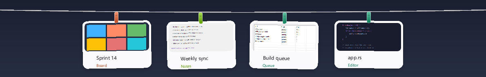

# 晒窗 · ShaiWin

**常用的窗口挂起来，随点随用。**



---

## 软件介绍

晒窗是一个 Windows 桌面小工具，只做一件事：**把你正在用的窗口从屏幕上「摘下来」，挂到屏幕顶端的一根晾衣绳上。**

抓住任意窗口的标题栏往屏幕顶端一拖，它就像被吸上去一样缩成一张卡片，垂在绳子上；点一下卡片，它长回原来的大小——拖着挂上去的在屏幕正中打开，用热键挂起的回到原来的位置。桌面立刻干净，但窗口没关、也没从任务栏和 Alt+Tab 里消失：它是**原地最小化**挂在架上的，任务栏按钮点一下就回桌面——就算晒窗自己崩了或被强杀，你也永远找得回它。

它和窗口管理器的关系是**克制**的：

- 只挂你亲手挂上去的窗口，不接管、不整理、不猜测。
- 不隐藏任务栏按钮，不改动 Alt+Tab，不动系统的 Snap 布局。
- 单个 exe，绿色免安装，不需要管理员权限。

适合的场景：日常工作中运行的软件窗口过多，多窗口无法快速定位。

---

## 下载与构建

### 方式一：直接下载（推荐）

到 [Releases](https://github.com/19y/ShaiWin/releases/latest) 下载最新的 `shaiwin-<版本>-win64.zip`，解压到任意目录，双击 `shaiwin.exe` 就能用。

- 单个 exe，绿色免安装，不需要 .NET / VC++ 运行库，不需要管理员权限。
- 压缩包里只有 `shaiwin.exe`、`LICENSE`、`README.md` 三个文件；卸载 = 删掉目录 + 删掉 `%LOCALAPPDATA%\ShaiWin\`。
- 每个 release 都附带 `SHA256SUMS.txt`，想校验下载完整性：

  ```powershell
  certutil -hashfile shaiwin-<版本>-win64.zip SHA256
  ```

- 双击以后托盘出现一张床单图标，屏幕顶端那根绳子就是它——拖一个窗口的标题栏到绳子上，松手。

**运行要求**：Windows 10 1809+ 或 Windows 11，x64。

> 维护者：改完 `Cargo.toml` 里的 `version`，`git tag v<版本> && git push origin v<版本>` 就会触发 GitHub Actions，自动跑测试、构建、打包并创建对应的 release（见 `.github/workflows/release.yml`）。想在本地出同一个产物就跑 `scripts\package.ps1`：步骤、flag 和检查与 workflow 一一对应，产物是 exe + LICENSE + README 三个文件打成的 zip，外加 SHA256SUMS.txt。

### 方式二：自己搭建环境构建

```powershell
rustup default stable-x86_64-pc-windows-msvc   # 或 -gnu
cargo build -p shaiwin --release              # -> target\release\shaiwin.exe
cargo run -p shaiwin                          # 开发构建
```

**环境要求**

| 工具 | 版本 | 用途 |
| --- | --- | --- |
| Windows | 10 1809+ / 11，x64 | 运行 |
| Rust | stable 1.82+（edition 2021） | 全部 crate |
| MSVC 或 MinGW-w64 | VS 2022 Build Tools（C++ 桌面开发）/ WinLibs | 链接 |
| Windows SDK | 10.0.19041+ | `rc.exe`，把图标编进 exe |
| Visual Studio `cvtres.exe` | 随 MSVC 安装 | GNU 目标把 `.res` 转成 COFF；找不到也能构建，只是 exe 没有图标 |
| Node.js | 18+（可选） | 只在重新生成/校验图标和 README 用图时用 |
| PowerShell | 5.1（系统自带） | 端到端脚本 |

图标由 `crates/app/build.rs` 编进 exe，资源编译器都找不到时只打一行 warning，构建仍然成功。只改 Rust 代码时不需要 Node，也不需要资源编译器。CI 用的是 `windows-latest` + MSVC 工具链，本地用 GNU 工具链构建出来的代码完全一样。

### 验证

```powershell
cargo test --workspace                                                   # 82 个单元测试
cargo clippy --workspace --all-targets -- -D warnings
powershell -NoProfile -ExecutionPolicy Bypass -File scripts\smoke-test.ps1
```

十个端到端脚本共用 `scripts/testkit.ps1`（Win32 声明、临时夹具窗口、独立 `LOCALAPPDATA`），跑的是真实窗口管理器，不碰你自己的窗口：

| 脚本 | 覆盖 |
| --- | --- |
| `smoke-test.ps1` | 挂起 → 渲染 → 强杀恢复 → 取下 |
| `hook-test.ps1` | 钩子、取消挂起、真鼠标拖拽上架 |
| `edge-test.ps1` | 重复挂起、外部恢复、最大化、程序退出 |
| `reveal-test.ps1` | 非常驻模式下的顶端按钮、悬停即时展开、计时自动收起、空绳不因点开窗口就消失 |
| `zorder-test.ps1` | 卡片层只跟指针：指针落到工作窗口（不用点）就沉到它底下、卡片原来的位置被盖住时不算把手、看得见的卡片本身就是把手（悬停即回顶层并且接得住点击和右键）、单独绳子的热区能把沉下去的卡片叫回来、拖任何窗口时卡片都不上来、绳子热区加宽但有边界、卡片之间的走廊不断线（横扫中途不沉、离开有 0.7 秒宽限、点了桌面立刻沉）、单独的绳子层仍在最上、只剩绳子时气泡解释一次并且每次沉下去都再来一次、气泡只有「不再提示」那颗按钮接点击（左半边点穿、点了才真的不再提示）、Esc 收起 |
| `cards-test.ps1` | 多张卡片各占一格、拖动换位、可点区域、× 只摘掉指针底下那一张卡片（窗口不动、日志里没有它） |
| `position-test.ps1` | 六种情形下点卡片回原坐标 |
| `resize-test.ps1` | 侧边调宽、底边调高、重启后保持 |
| `settings-shot.ps1` | 设置窗口四种状态的截图，并真的点快捷键框、点 × 、点保存 |
| `hang-latency.ps1` | 挂起链路分段计时：排队、快照、规划、停靠、首帧各花多少毫秒 |

夹具窗口都是最小化的，所以「已经挂上」在脚本里等于「最小化、并且还认得某块屏幕上的一个矩形」——是**碰到**那块屏，不是完整落在里面：一个夹具贴着边挂出去几个像素，仍然是用户留下的那个位置。真鼠标拖卡片之前脚本会先把线抬起来，因为被别的窗口盖住的卡片位置本来就不接点击。

改完请跑上面三条命令。要动渲染或挂起判定，先在真机上手工验一遍，机器验不了的在说明里写清楚「还没验的」，不要写成做完了。

---

## 功能介绍

### 挂起与取下

| 操作 | 效果 |
| --- | --- |
| 把窗口顶边拖到绳子上（卡片本体不算，垂在绳子下面的那段不接） | 衣架展开、绳子变暖，松手挂起 |
| `Ctrl+2`（可改） | 挂起当前窗口 |
| `Ctrl+T`（可改） | 展开 / 收起晾衣架 |
| 鼠标停在屏幕最顶端（非常驻时） | 弹出「展开晾衣绳 · 卡片数」小按钮；指针在按钮上一动就展开，碰巧落上去则 80 毫秒（空绳 220 毫秒）后展开 |
| 点击卡片 | 窗口长回原来的大小，**仍然挂着钩**（在哪打开见下） |
| 右键卡片 | 取下 / 取消挂起 / 设置或清除标签 |
| 点卡片右上角的 ×（只有指针底下那张卡片画得出这个按钮） | 只把这张卡片摘掉，窗口不碰：挂着的继续最小化，任务栏按钮点它就能回来 |
| 把挂着的窗口最小化 | 钩还在就自己回架，原地挂起，不会先闪回桌面 |
| 退出程序 | 所有窗口各自最小化在它打开时的位置，不会把窗口弄丢 |

窗口打开在哪里，取决于它当初怎么上去：

- **拖上架的**：打开在当前屏幕的正中间，大小不变。把窗口拖走挂起来，通常就是不想再看它原来待的地方。
- **热键挂起的**（`Ctrl+2`）：回到原来的位置，大小不变。
- 最大化的窗口照旧全屏打开，两种方式都一样；这个选择记在挂起日志里，重启后不变。

「取下」和「取消挂起」是两件事：前者只是把窗口放回桌面，之后它最小化还会自动回来；后者才是彻底不管这个窗口——而且**不碰它**，本来最小化的继续最小化，不会硬把它塞回屏幕。卡片上的 × 和菜单里的「取消挂起」是同一个动作。托盘的「全部取下」仍旧把每一个窗口都放回桌面，因为它要的就是这个。

衣架收起时，把窗口移到屏幕顶端不会点亮衣架，也不会把它挂上去；想用拖拽挂起，先让衣架展开。

### 晾衣架本身

- **沿绳拖动卡片**换位置，停在放手的地方；多张卡片各占一格，不会重叠。
- **拖卡片侧边 / 下边缘 / 底角**调宽 / 调高 / 同时调，重启后保持。
- 卡片多到一屏放不下时，按住卡片横向拖动。
- 衣架有两种显示方式。**启动时一定会展开一次**（约 4 秒），不然收在屏幕顶端看不出软件到底开没开。常驻时之后一直显示，用「展开 / 收起」快捷键或 Esc 收起或展开；非常驻时平时收起，鼠标滑到屏幕顶端会**立刻**弹出「展开晾衣绳 · 卡片数」小按钮。**指针一在按钮上移动，衣架马上展开**，不用点、也不用等；如果指针只是碰巧落在那儿，80 毫秒（空绳 220 毫秒）后也会展开。卡片位置不变。
- 非常驻的收起看的是**指针在不在衣架上**：指针停在绳子或卡片上、按着卡片、正在拖窗口、标签编辑框开着、右键菜单开着，都算「还在用」，一直显示；指针离开后 **1 秒**收回（`auto_hide_secs` 可改，`0` 表示只手动收起）。点线外、或别的窗口到前台，表示这次查看结束了，0.28 秒就淡出。**空绳是例外**：绳上没卡片时，你多半正走去挑要挂的窗口，点进那个窗口不算离开，指针离开后也至少留 4 秒，不会刚选好窗口线就没了。
- 卡片层不是常驻顶层，**指针落在绳子上、停在一张真看得见的卡片上、手上有卡片或标签编辑框开着时它才置顶**。正在拖任何窗口的时候它一定不置顶——拖拽往往就是奔着屏幕顶端去的，整排卡片挡在窗口前面正是最碍事的东西；绳子自己的置顶层仍然亮着，告诉你可以往哪儿放。挂上一个窗口不会把整排卡片拉回来：新窗口落在卡片墙上，绳子自己的置顶层告诉你它挂到哪了，指针回到绳子上才展开。指针离开线（去用桌面上的任何东西）卡片层立刻沉到当前窗口**底下**——不是只清掉置顶样式（那只是让它站到普通层最前面，照样盖着你）。
- 沉下去以后，**看得见的卡片和绳子都是把手**。指针停在一张真的露在外面的卡片上，卡片层立刻回到顶层并接住点击和右键——不用先绕到绳子上去；指针进到绳子的热区里则停约 0.14 秒再回顶层。热区比绳子画出来的那几像素宽——上下各 14 逻辑像素（100% 下是 28 像素高的一条），瞄准不累；同时它离卡片顶边还差 8 像素，所以不会把卡片所占的那一条也算成把手。**被别的窗口盖住的卡片位置不是把手**：卡片墙的高度正好是用户窗口所在的高度，在那里随手操作任何东西都不该弹出整排卡片；指针只是扫过绳子那一下（比如去点窗口标题栏）也不会把整排卡片拉回来。卡片已经上来以后不用等：指针停在卡片上就一直保持。
- **卡片已经上来以后，一条横向扫过去不会中途丢**。相邻两张卡片之间有一整条卡片高的空档（绳子在 26，卡片从它下面 22 开始），按上一句的死规矩，指针走到那儿就既不在绳上也不在卡片上，卡片会当场沉下去——于是「扫绳子 → 伸手够卡片 → 卡片没了 → 再扫绳子」的圈。现在整条线占住的那一条带子算「正够着它」：**只保命、不抢顶**，把手仍然是绳子和卡片，停在带子里的手不会把卡片压到别人窗口上面；带子到卡片底边为止，卡片下面那点空地是你自己的窗口。从带子里出去要多等 0.7 秒才沉，手一抖擦过边缘再回来不算离开；但在桌面上点了一下、或别的窗口抢到前台，就是你说「看完了」，0.7 秒立刻作废。
- 只剩一根绳子（卡片沉下去了）的时候，绳下会挂出一个**气泡**：「鼠标悬浮或滑过绳子，卡片就会浮上来」，右边一个「不再提示」按钮。它每次卡片沉下去只弹一回，6 秒后淡出；指针停在气泡上会多留一会儿。气泡左半边是**点穿的**——它在的位置底下可能是你自己的窗口，那句话你只要读；只有右边那颗按钮接得住点击，手型光标也只在那里出现，按下去以后就不再弹。想让气泡回来：删掉 `%LOCALAPPDATA%\ShaiWin\settings.txt` 里的 `raise_known=1` 那一行，重启晒窗。
- **右键菜单和卡片一起留在顶层**：Win32 弹出菜单本身就是一个置顶窗口，而 Windows 让置顶的弹出菜单始终盖在其它置顶窗口上面——卡片层也算在内。所以打开菜单不需要卡片让位：卡片保持原来的 z 序，菜单画在卡片上面，绳子仍然由卡片层自己画，整条线不会断开、也不会被菜单往下挤。卡片层本来已经沉在下面时也不会被菜单顺手拉上来。菜单关掉之前指针怎么动卡片层都不会改变 z 序。菜单开着、标签编辑框开着都算「还在用」，非常驻的计时会暂停，不会出现只剩一个菜单悬在空中的情况。
- 右键卡片 →「设置标签…」直接在卡片下方的输入框里打自己的短标签，没有预设列表。**每敲一个字，背后的卡片就实时变化**：标签带的颜色由文字算出，同一个词永远同一个颜色，一眼能在满屏卡片里认出它。标签带占满卡片顶部一整条，13 号半粗字，屏幕上不眯眼也能读；输入框就是一个**普通的系统编辑框**，光标、选区、输入法（含中文联想）全部归 Windows 管，程序不自己画光标——所以中文输入法提交两个字以后插入点不会再跳回开头，继续输入也不会跑到文字前面。有一点 Windows 自己不做好：气泡打开几秒以后它会**自己停掉光标闪烁**，窗口还是前台、还是激活、还是有焦点，光标就是不动，看着像一张不能输入的图片；只有「再显示一次光标」能重启那把闪烁的时钟，`SetCaretBlinkTime` 和 `SetFocus` 都不行，所以程序按一个闪烁周期把光标收放一次，落点还是 Windows 本来要显示的那一下。编辑框高度按字体实际行高算（一行加均匀的气，不再是给 13.5 号字准备的 40 逻辑单位的大箱子），字在这行里**居中画**，中文字的下半部分不会被裁掉。**改已有标签时光标停在文字末尾**，不用先按 End。回车保存，Esc 撤回，点空白处或点别的卡片也会保存。菜单和编辑框里都有「清除标签」。标签记在挂起日志里，重启后还在。

- 支持多显示器与 Per-Monitor V2 DPI：**指针在哪块屏，衣架就在哪块屏**，卡片和绳子一起搬过去，并按那块屏的 DPI 重算挂起区；50 毫秒内跟上，不用重启。按着卡片或标签编辑框开着时不会把衣架从手底下抽走；拖窗口跨屏时，衣架跟着窗口落点走。

### 快照与外观

- 窗口快照走 `PrintWindow(PW_RENDERFULLCONTENT)` → 旧式 `PrintWindow` → 抓屏三级兜底。
- 抓不到画面时（Chrome / Electron / 部分游戏的空白客户区），显示**应用色渐变 + 大图标 + 标题**的占位卡，而不是一块白。程序崩溃后恢复出来的卡片也是这一张：窗口最小化在架子上，最小化的窗口没有画面可抓——这是「崩了也找得回」换回来的代价。
- 同一个应用的卡片同色（FNV-1a 哈希落到 12 色板）。
- 弧线飞行、弹簧落针、阵风摆动，落针不是硬切。
- 中英文界面与托盘菜单跟随系统语言。

### 资源与性能

- 文字标签交给系统 GDI 绘制，不再在进程里解析微软雅黑整套字形：一屏卡片时私有内存约 11 MB、工作集约 27 MB（此前是 180 MB 上下）。
- 合成画布与 DIB 复用，动画期间不再每帧重新分配几 MB 内存；DIB 只在装不下时才变大。
- 飞行动画期间面板尺寸取整段飞行的包围盒，不再每帧 `SetWindowPos` 并重建分层窗口的背面缓冲。
- 按实测帧成本自动降帧（16 / 33 / 50 ms），低配机器上宁可少几帧，也把桌面还给系统。
- 外观轮询只比句柄和进程 ID；「自己是否提权」只查一次并缓存。
- 托盘提示只在卡片数量变化时发送，且只改文字不重设图标。挂完窗口后前台交给一个真实可见的窗口（先往下找，再从 z 序顶端找，最多试 3 个），不会留下看不见的窗口占着前台、让任务栏按钮一直亮着；任务栏不会因为程序自己而闪烁。

### 稳定性

- **挂起和打开都不闪**：挂起是把窗口按它进来时那份位置信息**原地最小化**，没有「先回普通大小再消失」的一步；最大化的窗口取下时先移到全屏矩形再套用最大化，Windows 的放大动画没有距离可走，直接就位。**取下也不闪**：点卡片时先把这一帧重画成「卡片已经离开」再让窗口回来，卡片层不会带着那张小卡片压在刚出现的窗口上等下一帧。
- **点了就回来**：点卡片时窗口立刻换到前台，即使当时焦点在别的程序上；不需要再去点任务栏按钮。
- **崩了也找得回**：挂起就是系统自己的最小化，所以晒窗被强杀或崩溃以后，任务栏按钮点一下窗口就回到它挂起前的位置——不需要有人在运行。挂起前还会先写日志，重启时用「窗口句柄 + 进程 ID + 进程创建时间 + 停靠矩形」四重校验，确认还是那个窗口才恢复成卡片。
- 取下失败有兜底：**判定看窗口最后真的落在哪儿，不看 API 怎么说**——一个最小化的窗口会一边答「成功了」一边不理它刚拿到的矩形，回到自己记住的那个位置。对不上就用 `SetWindowPos` 补；仍失败则卡片飞回并提示原因，窗口不会失联。
- 管理员权限的窗口会被 UIPI 挡住，程序直接拒绝并弹出原因，不会假装成功。任务管理器默认以管理员权限运行，想挂它请用「以管理员身份运行」重新打开晒窗。
- 保守过滤：只处理可见、有标题、非工具窗、非 cloaked、非最小化的窗口。
- 运行日志在 `%LOCALAPPDATA%\ShaiWin\shaiwin.log`，出问题先看这里。

### 托盘与设置

右键托盘图标：全部取下、展开/收起、设置、开机启动、退出。挂起窗口不放在这里：托盘菜单是在指针旁边点的，手边没有“当前窗口”，要挂就用 `Ctrl+2` 或把窗口拖到绳子顶端。

托盘「设置」打开一个独立窗口：两个快捷键、晾衣架弧度、衣架常驻、拖到顶部挂起。出厂默认后两项都是**开**：衣架一直显示，把窗口拖到屏幕顶端松手就挂上。弧度按住绳子往下拉，一格像素是 0.1%；拉完还能用方向键以 0.1% 微调、PageUp/PageDown 以 1% 跳、Home/End 到两端，双击绳子回到自动弧度，右下角的数字就是当前值。快捷键框按下后等组合键，按 × 清空。不带修饰键的快捷键保存时会被拒绝并说明原因。

窗口没覆盖的项直接改 `%LOCALAPPDATA%\ShaiWin\settings.txt`，重启晒窗生效。全部键：

| 键 | 作用 |
| --- | --- |
| `hang_mods` / `hang_vk` | 挂起当前窗口的快捷键 |
| `toggle_mods` / `toggle_vk` | 展开/收起的快捷键 |
| `sag` | 绳子弧度，占线宽百分比 0–16；留空或 `-1` 用自动弧度，设置窗口能拉到整条线的 0–16 |
| `always_on` | 衣架常驻显示，默认开；`0` 改为顶端小按钮短暂展开（启动那一次展开两种模式都有） |
| `auto_hide_secs` | 非常驻时指针离开衣架后多久收起，默认 `1`（1–30 秒，空绳至少留 4 秒）；`0` 只手动收起（Esc 或快捷键），点线外也不会自动收 |
| `drag_hang` | 拖窗口到顶部挂起，默认开；收起时不会误挂，`0` 则只能靠快捷键挂起 |
| `reduced_motion` | 减弱动画 |
| `excluded` | 按可执行文件名的排除名单 |
| `raise_known` | 程序自己写的，不是你设的：气泡上点过「不再提示」就是 `1`，之后不再弹。想让它重新弹，删掉这一行重启 |

旧版留下的 `hover_open=`、`tags=`、`all_monitors=` 会被忽略，删掉那行即可。同目录还有 `parked.txt`（挂起日志，退出后自动清空）和 `shaiwin.log`。卸载时删掉整个 `%LOCALAPPDATA%\ShaiWin\` 就行。

---

## 待开发功能清单

### Windows

**v0.2 · 手感与日常可用**

- [ ] 滚轮滚动晾衣绳：卡片多到一屏放不下时，滚轮在绳子上横向滚动/翻页。现在只能按住卡片沿绳子拖，而卡片本身还兼着点击和抓边，多卡场景不够用
- [ ] 每个显示器一条独立的晾衣架（当前是「跟着最后一次挂起走」的单线）
- [ ] 卡片重排动画：插入/移除时邻居平滑让位
- [ ] 「减弱动态效果」跟随系统设置（`SPI_GETCLIENTAREAANIMATION`）
- [ ] 空线时的引导文案与首次使用引导（只剩绳子、卡片沉下去时那根绳子已经会自己解释「怎么把卡片叫回来」了；绳上一张卡片都没有时该怎么挂上去，还没有话）
- [ ] 自定义卡片特征信息


**v1.0 · 发布**

- [ ] 安装包（MSIX 或 Inno Setup）与卸载时恢复所有窗口
- [ ] `winget` / Scoop 清单
- [ ] 代码签名（未签名 exe 会被 SmartScreen 拦）
- [ ] 崩溃上报（默认关闭，需显式同意）
- [ ] 性能回归基准：空闲 CPU < 0.1%，挂 20 张卡片动画 60 fps

### macOS

`platform/macos/` 里已经放了一份**没有在 macOS 上编译过、也没运行过**的骨架（`Package.swift` + `CShaiWin` modulemap + 薄封装 + 最小 AppKit 入口）。它的作用只是让有 Mac 环境的贡献者不从零开始。下面把「还没做」和「可以直接复用」分开写清楚。

**macOS 上还没实现的**

| 部分 | 状态 | 说明 |
| --- | --- | --- |
| 窗口枚举 | 未实现 | 需要 `CGWindowListCopyWindowInfo` 列窗口、`AXUIElement` 拿标题与位置 |
| 窗口移动 / 停靠 | 未实现，且方案未验证 | `AXUIElementSetAttributeValue(kAXPosition)` 移到屏幕外会不会被系统拉回，Mission Control 会不会仍显示它，都要先在真机上试 |
| 停靠兜底方案 | 未实现 | 若上面的方案不成立，退到 `NSWindow.miniaturize()` 走系统最小化，卡片上放「恢复按钮 + 快照」，但失去「窗口真的消失」的体验 |
| 窗口快照 | 未实现 | `ScreenCaptureKit`，需要屏幕录制权限；没有权限时只能走占位卡 |
| 权限流程 | 未实现 | Accessibility / Screen Recording / Input Monitoring 三个权限的申请、引导与拒绝后的降级 UI |
| 菜单栏图标 | 只有骨架 | `NSStatusItem` 的菜单项、状态、i18n 都没接 |
| 全局快捷键 | 未实现 | `NSEvent.addGlobalMonitorForEvents` 或 `MASShortcut` |
| 渲染 | 未实现 | 计划 `NSView` + `CALayer`；现在只有一块透明面板和一条绳子 |
| 拖拽上架检测 | 未实现 | Windows 侧是轮询 + 系统移动循环判定，Mac 侧要重写 |
| 设置、日志、崩溃恢复 | 未实现 | `settings.txt`、`shaiwin.log`、四重校验恢复都还是 Windows 专属 |
| 多显示器 / Retina | 未实现 | 多屏坐标与 2x 位图适配 |
| 打包与签名 | 未实现 | `.app` 打包、公证（notarization）、`.icns` 图标 |

**macOS 可以直接复用的（`crates/core` 全部，经 `crates/ffi` 的 C ABI 调用）**

| 能力 | 复用方式 |
| --- | --- |
| 槽位布局、绳垂、最大数量 | `shaiwin_layout_*`，已导出 |
| 飞行弧线（起落点、路径） | `shaiwin_flight_*`，已导出 |
| 弹簧落针 | `shaiwin_core::spring` 已在 Rust 侧完整实现并有单测，但**尚未导出到 C ABI**，补一层 `#[no_mangle]` 包装即可 |
| 配色与设计尺寸 | 现在是 Rust 常量，Swift 侧先照抄同样的数字，后续补 `shaiwin_theme_*` |
| 命中测试、卡片索引 | `shaiwin_core::hit` 已有逻辑，`shaiwin_layout_index_at` 还需导出 |

结论：**手感相关的数学一行都不用重写**，Mac 外壳只负责 `NSWindow` / `AXUIElement` / 渲染 / 权限这四件事。构建方式（`cargo build -p shaiwin-ffi --release` 拿到 `libshaiwin.a`，再 `swift build` 链接）写在 `platform/macos/README.md` 里。

---

## 项目目录架构

```
ShaiWin/
├── .github/
│   └── workflows/
│       └── release.yml         打 tag 推送后自动测试、构建、打包并创建 release
├── Cargo.toml                  workspace：四个 crate，release 开了 LTO / strip / panic=abort
├── Cargo.lock
├── LICENSE                     MIT + Commons Clause
├── crates/
│   ├── core/                   纯 Rust，无系统依赖
│   │   ├── layout.rs           槽位布局、绳垂、最大数量、挂起区判定
│   │   ├── spring.rs           弹簧积分（超大 dt 也不炸）
│   │   ├── anim.rs             飞行弧线：起落点与路径
│   │   ├── theme.rs            配色（FNV-1a → 12 色板）与设计尺寸
│   │   ├── hit.rs              命中测试、卡片索引
│   │   └── lib.rs
│   ├── platform-win/           Win32 层，不碰 UI
│   │   ├── window.rs           窗口枚举、保守过滤、前台/恢复
│   │   ├── park.rs             原地最小化停靠（placement + 按实际矩形校验兜底）
│   │   ├── capture.rs          PrintWindow 三级快照 + 空白检测
│   │   ├── dib.rs / image.rs   DIB 读写、按哨兵色裁边
│   │   ├── icon.rs             ExtractIconEx + GetDIBits（含 1bpp 掩码兜底）
│   │   ├── monitor.rs          多显示器、Per-Monitor V2 DPI
│   │   └── lib.rs
│   ├── app/                    Windows 外壳：把上面两层接起来
│   │   ├── main.rs             入口、单实例互斥、消息循环
│   │   ├── line.rs             分层窗口（晾衣绳本体）与状态机
│   │   ├── render.rs           tiny-skia 渲染管线、卡片贴图缓存
│   │   ├── app.rs              挂起/取下编排、plan → 写日志 → execute
│   │   ├── worker.rs           后台线程：快照、图标提取
│   │   ├── journal.rs          挂起日志与崩溃恢复的四重校验
│   │   ├── tray.rs             托盘图标与菜单
│   │   ├── settings.rs         settings.txt 读写
│   │   ├── settings_ui.rs      设置窗口：五个自绘子类，没有一个是标准控件
│   │   ├── tag_ui.rs           卡片底下的标签编辑弹层：一个系统 EDIT，其余全自绘
│   │   ├── text.rs             走 GDI 的文字位图（把 155 MB 的字形解析换掉）
│   │   ├── i18n.rs             中英文
│   │   ├── log.rs              shaiwin.log
│   │   ├── ico.rs              exe 图标资源
│   │   └── build.rs            把 .ico 编进 exe（windres / rc.exe + cvtres.exe）
│   └── ffi/                    C ABI，给未来 macOS 外壳复用 core
│       └── lib.rs
├── include/
│   └── shaiwin.h               上面这层的头文件
├── platform/
│   └── macos/                  未验证的 Swift/AppKit 骨架
│       ├── Package.swift
│       ├── README.md           分工、停靠方案、权限、还缺哪些导出
│       └── Sources/
│           ├── CShaiWin/module.modulemap
│           ├── ShaiWinCore/    对 C ABI 的薄封装
│           └── ShaiWin/        最小 AppKit 入口
├── scripts/
│   ├── testkit.ps1             端到端脚本共用的 Win32 声明与夹具窗口
│   ├── smoke-test.ps1 等 9 个  端到端测试
│   ├── build-icon.mjs          SVG → 九个尺寸 → assets/shaiwin.ico
│   ├── preview-icon.mjs        把九个尺寸拼成 assets/icon-preview.png 供肉眼检查
│   ├── check-exe-icon.mjs      核对 exe 里的图标资源与 .ico 是否一致
│   └── usage-shot.ps1 等       README 用图
├── assets/                     README 用图、图标、收款码
└── dist/                       本地产物
```

分层原则：`core` 不知道 Windows 存在，`platform-win` 不知道 UI 存在，`app` 只做编排。所以 macOS 外壳可以只换掉 `platform-win` 和 `app`，`core` 原样复用。

---

## 许可

本项目采用 **MIT License + Commons Clause** 授权，完整法律条款见 [LICENSE](LICENSE)。

**授权范围**

在保留版权声明与本许可声明的前提下，任何个人或组织均可免费取得本软件的副本，并有权使用、复制、修改、合并、发布、分发及再许可本软件，不受使用场景与部署规模的限制，包括：

- **商业与办公用途**：企业内部部署、日常办公使用、批量安装于任意数量的设备，均无需事先申请授权，亦不产生任何费用。
- **二次开发与再分发**：可修改源代码、变更名称、以闭源方式分发，或整体、部分地集成至自有项目。

**限制条款**

依据 Commons Clause，上述授权**不包括**向第三方销售本软件的权利。即不得将本软件或其衍生作品作为商品或服务**有偿**提供给第三方，包括但不限于：销售本软件；销售价值全部或主要来源于本软件功能的产品或服务；以收费方式提供与本软件相关的部署、托管、运维或定制开发服务。

如需取得上述销售授权，请在仓库提交 issue 说明用途。

> 说明：Commons Clause 不属于 OSI 认可的开源许可，本项目的授权模式为 source-available——源码照常公开，仅保留「不得销售」一项权利。代码托管平台可能将许可证标识显示为 `Other`。

---

## 请我喝杯咖啡

如果晒窗帮你少找了几次窗口，可以请我喝杯咖啡。


